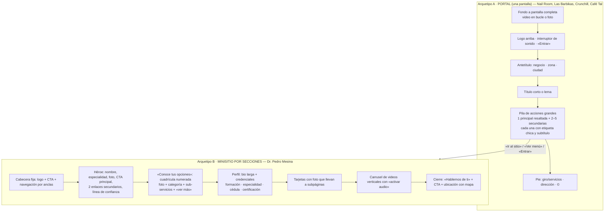

# tubio → minisitios por giro que rematan en WhatsApp — especificación funcional (v2, 30-oct-2026)

Pedido de Alejandro vía master (#324 → #325, ajuste #326 → #329): **enfocar en el diseño funcional de los minisitios y
del home**: qué secciones, bloques, plantillas por giro y CTA de WhatsApp necesita el motor de tubio para reproducir lo
que hace hellolink.mx. **Esto es para `dev` (datos y comportamiento)**; el sistema visual lo hace `design` en paralelo.
Precio: fuera de este documento (lo decide Alejandro aparte).

Fuentes: capturas de referencia en `remote/shared/proyectos/tubio/design/hellolink-ref-2026-10-31/` (home de hellolink,
Dr. Pedro Mesina, Nail Room, Café Tal, Las Barbikas, Crunchill; 390 px y 1366 px), análisis de master
(`shared/proyectos/tubio/notas/2026-10-31-master-hellolink.md`) e inventario de bloques de tubio (`src/modules/bio`).
**Sala limpia:** sólo funciones observables; ni código de AltumCode ni del tema Shopify de hellolink; textos, nombres y
diseño son propios.

---

## 1. Lo que muestran las capturas: dos arquetipos de minisitio



Observaciones que cambian el motor de tubio:
1. **Un sitio = varias páginas.** El portal es la puerta; «Ver menú», «Ir al sitio», «Café Tal» abren **subpáginas del
   mismo negocio** (Café Tal vive dentro de Nail Room). Hoy una página bio de tubio es una sola página.
2. **La página es una sucesión de secciones a todo lo ancho**, cada una con su fondo y su ancla; los bloques viven dentro.
   Hoy tubio apila bloques en una columna angosta.
3. **El héroe es media página o pantalla completa con video**, no un avatar redondo.
4. **Las acciones son tarjetas-botón con jerarquía** (principal grande, secundarias en rejilla de 2), con etiqueta
   («A DOMICILIO», «PEDIDO POR TELÉFONO») y subtítulo («Abrir plataforma», «Efectivo, tarjeta o transferencia»).
5. **Todo termina en una acción concreta**: agendar, pedir, llamar, cómo llegar, abrir app de reparto, WhatsApp.
6. **Contenido tipado por giro**: categorías de procedimientos, credenciales médicas, menú, servicios, ubicación.

---

## 2. Cambios al motor (para `dev`)

### 2.1 Sitio con páginas y secciones
| Concepto | Hoy en tubio | Nuevo |
|---|---|---|
| Sitio | 1 página bio por alias | **Sitio** = alias + N páginas: `/<alias>` (inicio) y `/<alias>/<pagina>` (menú, servicios, el-doctor…); en dominio propio, `/` y `/<pagina>` |
| Página | lista de bloques | lista de **secciones**; cada página tiene título SEO, OG y su propio orden |
| Sección | — | contenedor a todo lo ancho: `ancla`, `antetitulo`, `titulo`, `subtitulo`, `fondo` (color / imagen / video / degradado del tema), `alto` (auto · media pantalla · pantalla completa), `ancho_contenido` (angosto · normal · ancho), `columnas` (1 · 2 · 3 en escritorio; 1 en móvil), `visible` |
| Bloque | igual | vive dentro de una sección; los 60 tipos actuales siguen sirviendo |
| Cabecera del sitio | — | opcional por sitio: logo, navegación **generada de las anclas** de la página (o lista manual), botón de acción principal; fija al hacer scroll |
| Barra de acción fija | — | opcional por sitio: en móvil, barra inferior con 1–3 acciones (p. ej. «Agendar», WhatsApp, «Cómo llegar») |
| Pie del sitio | — | dirección corta, línea de servicios, redes, © y el «hecho con tubio» según plan |

Migración: cada página bio actual = sitio de 1 página con 1 sección angosta que contiene sus bloques → **nada se rompe**.

### 2.2 Bloques nuevos o ampliados — datos que pide cada uno

| Bloque | Datos (campos) | Comportamiento | Arquetipo |
|---|---|---|---|
| **Portada** (`hero`) | `medio` (video mp4/webm ≤ 15 MB, o imagen), `poster`, `logo`, `antetitulo`, `titulo`, `subtitulo`, `alineacion` (centro · abajo-izq), `oscurecer` (0–80 %), `sonido` (sí/no: muestra interruptor) | video en bucle, silenciado, `playsinline`; en ahorro de datos o `prefers-reduced-motion` muestra el póster | A, B |
| **Panel de acciones** (`action_panel`) | lista de **acciones** (abajo); `disposicion` (pila · rejilla 2 · principal + rejilla) | la 1.ª puede ser «principal» (resaltada) | A |
| Acción (elemento) | `etiqueta` (chica, mayúsculas: «A DOMICILIO»), `titulo` («UBER EATS»), `subtitulo` («Abrir plataforma»), `tipo` (enlace · WhatsApp · llamar · cómo llegar · página interna · ancla · app: Uber Eats/Rappi/DiDi), `destino`, `principal` (sí/no) | cuenta clics por acción; «app» intenta abrir la app nativa (ya existe «abrir en la app») | A, B |
| **Navegación de secciones** | automática de la cabecera | resalta la sección visible | B |
| **Categorías / opciones** (`category_grid`) | elementos: `foto`, `numero` (auto 01–n), `titulo`, `sub_items` (lista corta), `enlace` (página interna o ancla) y `texto_enlace` | cuadrícula 2 (móvil) / 3 (escritorio) | B |
| **Perfil profesional** (`profile`) | `foto`, `nombre`, `especialidad`, `bio` (markdown), `credenciales` [{`etiqueta`: «Formación médica», `valor`: «Universidad de Colima», `nota`: «Cédula 7433985»}], `enlace_verificacion` (p. ej. buscador de cédulas SEP) | credenciales en tabla de 2 columnas | B (salud, servicios) |
| **Línea de confianza** (`trust_line`) | 1–4 textos cortos («Consulta en Colima», «Certificación CMCPER 2278») | bajo el CTA del héroe | B |
| **Tarjetas con foto** (`photo_cards`) | elementos: `foto`, `antetitulo`, `titulo`, `enlace` | flecha, toda la tarjeta es clic | B |
| **Carrusel de videos** (`video_carousel`) | elementos: `video` (vertical) o URL de reel/short, `titulo`, `categoria`, `cta` opcional | deslizable, uno reproduce a la vez, botón «activar audio» | B |
| **Menú** (`menu`) | `categorias` [{`nombre`, `platillos` [{`nombre`, `descripcion`, `precio`, `foto?`, `etiquetas` (picante, vegano, nuevo, favorito), `disponible`}]}], `moneda`, `nota` | buscador y saltos por categoría; con carrito (ver §3) se vuelve pedido | A→subpágina |
| **Menú en PDF** (`menu_pdf`) | `archivo`, `portada` | visor a pantalla completa en móvil, descarga | A |
| **Carta de servicios** (`services`) | `categorias` [{`nombre`, `servicios` [{`nombre`, `descripcion`, `precio` (o «desde»), `duracion_min`, `foto?`}]}] | cada servicio puede llevar «Agendar» → Solicitud de cita con el servicio precargado | belleza, salud, servicios |
| **Propiedades** (`listings`) | elementos [{`titulo`, `operacion` (venta/renta), `precio`, `tipo`, `recamaras`, `banos`, `m2`, `colonia`, `fotos[]`, `descripcion`, `estado` (disponible/apartada/vendida)}] + `filtros` activos | filtros en el cliente; ficha en subpágina automática `/<alias>/propiedad/<id>` | inmobiliaria |
| **Horario de clases** (`class_schedule`) | `clases` [{`nombre`, `dia` (L–D), `inicio`, `fin`, `instructor?`, `cupo?`}] | cuadrícula semanal en escritorio, lista por día en móvil, «hoy» primero | fitness |
| **Programas** (`programs`) | elementos [{`nombre`, `descripcion`, `nivel`, `duracion`, `precio?`, `foto`}] | cada uno con «Clase muestra» | fitness |
| **Ubicación** (`location`) | `nombre_lugar`, `direccion`, `lat/lng` (o geocodificar), `referencias`, `horario` (reusa `hours`), `estacionamiento` | mapa estático ligero (sin JS de Google hasta tocar) + botones Google Maps / Apple Maps / Waze + «Cómo llegar» | A, B |
| **Plataformas de reparto** | dentro de Panel de acciones (`tipo: app`) | — | restaurantes |

Bloques actuales que se reutilizan tal cual: galería, carrusel, horario (`hours`), FAQ, reseñas, video, socials,
cupón, cuenta regresiva, formulario de contacto, markdown, CTA, portada simple (`cover_header`).

### 2.3 CTA de WhatsApp con campos — «Solicitud por WhatsApp» (`wa_request`)

Un bloque (o una acción del Panel) que abre una **hoja inferior** con 1–5 campos y termina en `wa.me`.

| Campo de configuración | Ejemplo |
|---|---|
| `numero` (E.164; por defecto el del sitio) | +52 312 000 0000 |
| `preset` | cita · reservación · pedido · cotización · visita · clase muestra · tarjeta de regalo · libre |
| `titulo_hoja` / `texto_boton` | «Agenda tu valoración» / «Enviar por WhatsApp» |
| `campos[]`: `{clave, etiqueta, tipo, requerido, opciones?, ayuda?}` | tipos: texto, número, fecha, hora, franja (mañana/tarde/noche), elegir uno, elegir varios, teléfono, servicio (lista tomada de Carta de servicios), propiedad (de Propiedades), personas |
| `plantilla_mensaje` con variables | `Hola {negocio}, quiero agendar {servicio} el {fecha} por la {franja}. Soy {nombre}.` |
| `guardar_copia` (sí por defecto) | guarda la solicitud como **dato capturado** (ya existe la bandeja + avisos) |
| `aviso_legal` | «El negocio confirmará tu cita por WhatsApp» (siempre visible: es solicitud, no reserva) |

Presets (campos por defecto):
| Preset | Campos |
|---|---|
| Cita / valoración | servicio, fecha deseada, franja, nombre, ¿primera vez? |
| Reservación | fecha, hora, personas, nombre, ocasión (opcional) |
| Pedido | (viene del carrito del Menú) entrega: recoger/domicilio, dirección si domicilio, forma de pago (efectivo/tarjeta/transferencia), nombre |
| Cotización guiada | 2–6 preguntas definidas por el negocio (elegir uno / número) + nombre |
| Visita a propiedad | propiedad (precargada), día, franja, nombre |
| Clase muestra | programa/clase (precargada), día, nombre |
| Tarjeta de regalo | monto o servicio, para quién, de parte de quién, mensaje |

Reglas: el mensaje se arma **en el navegador** (nada sale del sitio sin que la persona toque «Enviar»); mide aperturas
de la hoja, envíos y abandono; en navegadores dentro de Instagram/TikTok usa el enlace universal de WhatsApp.

### 2.4 Carrito sin cobro (pedido por WhatsApp)
`menu` o `services` con `carrito: sí` → botón «+» por platillo, contador, nota por platillo, barra inferior «Ver pedido
(3) · $245» → hoja con resumen → preset Pedido → mensaje con líneas `2× Hamburguesa clásica — $180`. Sin pago en línea
(eso sigue siendo los bloques de pago existentes, aparte).

---

## 3. Plantillas por giro (estructura de secciones)

Cada plantilla = sitio con páginas + secciones + bloques precargados con contenido de ejemplo propio. El asistente de
primer uso (ya existe en v2) pregunta **el giro primero** y luego sólo pide lo que esa plantilla necesita.

| Giro | Página inicio (arquetipo) | Subpáginas | Acción principal |
|---|---|---|---|
| **Restaurante / café** | A: Portada video + Panel (Pedir por WhatsApp ★, Llamar, Uber Eats, Rappi, Ver menú, Entrar al sitio) | **Menú** (menu + carrito, o menu_pdf) · **Sitio** (galería, historia, horario, ubicación, reseñas) | Pedido / Reservación |
| **Belleza / uñas / barbería** | A: Portada video + Panel (Agendar ★, Ir al sitio) | **Sitio**: carta de servicios con «Agendar» por servicio, galería de trabajos, equipo, ubicación, horario | Cita |
| **Salud (médico, dentista, psicólogo)** | B: cabecera con anclas · héroe con foto + Agendar valoración ★ · línea de confianza · categorías de tratamientos · perfil con credenciales · videos · ubicación + cierre | **Procedimiento** (una por categoría: descripción, FAQ, antes/después, CTA) | Cita / valoración |
| **Inmobiliaria** | B: héroe + buscador (filtros) · propiedades destacadas · asesor (perfil) · ubicación | **Ficha de propiedad** (automática) | Visita |
| **Fitness / estudio** | B: héroe video · programas · horario de clases · instructores · ubicación | **Programa** | Clase muestra |
| **Servicios profesionales / oficios** | B: héroe · servicios con «Cotizar» · portafolio (galería) · reseñas · zona de cobertura | — | Cotización guiada |

Contenido de ejemplo: negocios ficticios con fotos libres; nunca los clientes de hellolink.

---

## 4. Qué cambia en el home de tubio.link

```mermaid
flowchart TB
  H0[Barra de anuncio] --> H1[Cabecera: logo · «Crear mi sitio» · WhatsApp de ventas]
  H1 --> H2[Héroe: promesa + «Reclama tu dirección»<br/>campo alias con vista en vivo tubio.link/tunegocio<br/>+ «Elige tu giro» (6 chips)]
  H2 --> H3[Vista previa viva: al elegir giro, un teléfono<br/>muestra la plantilla de ese giro con el nombre escrito]
  H3 --> H4[Ejemplos por giro: carrusel de teléfonos<br/>giro · nombre · «Abrir ejemplo»]
  H4 --> H5[Cómo funciona en 3 pasos:<br/>elige giro → llena lo básico → compártelo<br/>+ alternativa «lo armamos por ti»]
  H5 --> H6[Qué incluye: checklist<br/>diseño, galería, mapa y horarios, WhatsApp, dominio propio, estadísticas]
  H6 --> H7[Por giro: pestañas Restaurantes · Belleza · Salud · Inmobiliaria · Fitness · Servicios<br/>muestran los bloques de ese giro]
  H7 --> H8[Preguntas frecuentes]
  H8 --> H9[Cierre: «Crea tu sitio» + WhatsApp]
  H9 -.móvil.-> H10[Barra inferior fija: «Crear mi sitio» + WhatsApp]
```
| Elemento | Hoy (home link-in-bio) | Nuevo |
|---|---|---|
| Mensaje | herramienta de enlaces | **minisitio de tu negocio, listo hoy, que termina en WhatsApp** |
| Reclamar alias | existe | se queda, con **vista previa en vivo** en un teléfono |
| Giro | no | chips de giro en el héroe → cambia la vista previa y lleva a la plantilla al registrarse |
| Ejemplos | no | 1 ejemplo vivo por giro (`tubio.link/ejemplo-restaurante`…), hechos con el motor real |
| «Lo armamos por ti» | no | segunda vía en el héroe y en «cómo funciona»: formulario de alta asistida (giro, logo, fotos, textos, servicios/menú, WhatsApp, dirección) → cola interna |
| Contacto de ventas | Zammad hola@ | **WhatsApp de ventas** visible (cabecera, cierre, barra móvil) + Zammad sigue |
| Páginas por giro | no | `tubio.link/restaurantes`, `/belleza`, `/salud`… (misma estructura, ejemplo y bloques del giro; SEO local) |
| Ventajas propias | — | dominio propio incluido, lo editas tú, estadísticas de visitas y solicitudes, QR con estadísticas |

---

## 5. Orden de construcción para `dev`
1. **Motor: sitio → páginas → secciones** (+ migración 1:1 de páginas bio). Cabecera, barra de acción fija y pie. *L*
2. **Portada con video** + **Panel de acciones** + **Ubicación** → ya permite el arquetipo A completo. *M*
3. **Solicitud por WhatsApp** (presets, campos, plantilla de mensaje, copia como dato). *M*
4. **Menú** (+ carrito) y **Carta de servicios** → restaurante y belleza. *M*
5. **Categorías**, **Perfil profesional**, **Línea de confianza**, **Tarjetas con foto**, **Carrusel de videos** → arquetipo B / salud. *M*
6. **Propiedades**, **Horario de clases**, **Programas** → inmobiliaria y fitness. *M*
7. **Plantillas ×6** con contenido de ejemplo (con `design`) y asistente «giro primero». *M*
8. **Home nuevo** + páginas por giro + alta asistida «lo armamos por ti». *M*

Presupuesto público que se mantiene: HTML del servidor, JS sólo donde hace falta (hoja de WhatsApp, carrito, carrusel,
filtros), LCP < 1.5 s en 4G con póster en vez de video cuando no conviene.

## 6. Qué NO copiar
- Su forma: tipografías, colores, textos, nombres de secciones, el collage del home y los casos reales de Colima.
- Video de fondo **sin póster** ni respeto a ahorro de datos (pesa y falla en 4G).
- «Agendar» que parece reserva confirmada: en tubio siempre dice que el negocio confirma.
- Sitios sin editor para el dueño: en tubio todo lo de arriba se edita desde el panel.
- Shopify como motor de páginas y cotizador.

*Precio: fuera de alcance de este documento; lo decide Alejandro.*
