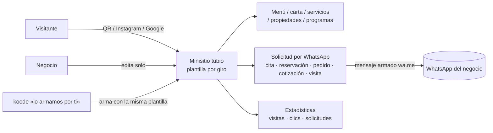
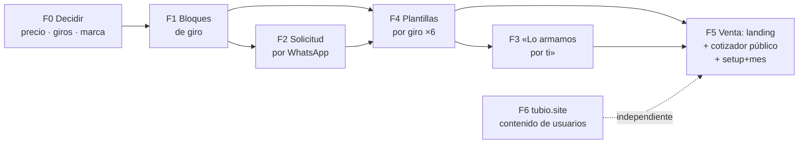

# tubio → «minisitios por giro que rematan en WhatsApp» (plan, 30-oct-2026)

Pedido de Alejandro (#324 → master → rea #325): «tubio.link debe convertirse en lo que es hellolink.mx».
Base: análisis de master (`remote/shared/proyectos/tubio/notas/2026-10-31-master-hellolink.md`), docs de tubio
(SPEC, ROADMAP-V2, IDEAS-V3, V2-FUNCIONES) e inventario del código de tubio v1.0.0 + rama v2 (`src/modules/bio`,
`templates`, `sites`, `plans`).

**Sala limpia.** Este documento habla sólo de **funciones visibles**. No se miró ni se cita código de AltumCode (la
referencia de la SPEC original) ni de hellolink (tema de Shopify). Nombres, textos, diseño y precios finales son propios.

---

## 0. La tesis en una línea
hellolink vende **el resultado hecho a mano** (minisitio por giro, contenido cargado por ellos, todo termina en
WhatsApp, un precio). tubio vende **la herramienta**. Convertir tubio = **mismo resultado con la mitad del trabajo
humano**: plantillas por giro con bloques tipados + bloques de «solicitud por WhatsApp» + un modo «lo armamos por ti»
que usa esas mismas plantillas. Ganamos donde hellolink no puede: el cliente edita solo, dominio propio incluido,
estadísticas, sin Shopify.

---

## 1. Funciones de hellolink vs tubio

Leyenda: ✅ existe · 🟡 parcial · ❌ falta. Esfuerzo (como en ROADMAP-V2): **S** ≈ 1 día · **M** ≈ 2–4 días · **L** ≈ 1–2 semanas.

### 1.1 Lo incluido en el plan base de hellolink
| Función hellolink | tubio hoy | Esf. | Nota |
|---|---|---|---|
| Sitio responsivo móvil primero | ✅ | — | v2 ya pasa `mobile-audit` |
| Información / historia del negocio | ✅ | — | párrafo, markdown, portada, artículo |
| Galería (≤20 fotos) | ✅ | — | `gallery`, `carousel` |
| Ligas a redes y apps | ✅ | — | `socials`, apertura en la app |
| Mapa interactivo + «Cómo llegar» | 🟡 | S | hay embed de mapa; falta bloque «Ubicación» con dirección, botón Cómo llegar (Google/Apple/Waze) |
| Horarios | ✅ | — | `hours` con «abierto ahora» (mejor que hellolink) |
| Teléfono y WhatsApp | 🟡 | S | hay `link`/`vcard`; falta **botón WhatsApp fijo** (flotante o barra inferior) con mensaje prellenado |
| Publicación + hosting + liga | ✅ | — | `tubio.link/<alias>` |
| Dominio propio | ✅ | — | **ventaja**: incluido y automático (hellolink lo hace a mano o no lo incluye) |
| Hecho por la agencia, sin editor para el cliente | ❌ | M | modo «lo armamos por ti» (§2 F3); en tubio el cliente además puede editar |

### 1.2 Paquetes por giro (contenido tipado)
| Giro hellolink | tubio hoy | Esf. | Qué falta |
|---|---|---|---|
| Restaurantes: menú PDF existente + galería | 🟡 | S | plantilla `restaurante` existe; falta **visor de menú PDF** bonito (hay bloque `pdf`) y el menú interactivo (1.3) |
| Belleza: carta ≤20 servicios con precio y duración + QR | 🟡 | M | `product` tiene precio, no **duración ni categorías**; falta bloque **Carta de servicios** y plantilla `belleza` |
| Salud: perfil + ≤8 servicios | 🟡 | S | plantilla `consultorio` existe; falta perfil profesional (cédula, especialidad) y carta de servicios |
| Inmobiliarias: ≤12 propiedades con precio/características | ❌ | M | bloque **Propiedades** (ficha: precio, recámaras, baños, m², fotos, ubicación) + plantilla `inmobiliaria` |
| Fitness: ≤8 programas + horario semanal en bloques | ❌ | M | bloque **Horario de clases** (cuadrícula semanal) + **Programas** + plantilla `fitness` |
| Servicios: ≤20 servicios + portafolio | 🟡 | S | galería sirve de portafolio; falta carta de servicios y plantilla `servicios` |

### 1.3 Add-ons de hellolink
| Add-on hellolink | tubio hoy | Esf. | Nota |
|---|---|---|---|
| QR con logo | ✅ | — | QR con logo, marco, dinámico y **con estadísticas** (mejor) |
| Menú interactivo (40 productos / 8 categorías, sin carrito) | ❌ | M | bloque **Menú** (categorías, platillo, precio, foto opcional, etiquetas: picante/vegano) |
| Motor de pedidos por WhatsApp (carrito sin cobro) | ❌ | M | el Menú/Catálogo con **carrito → mensaje wa.me** (IDEAS-V3 ya lo propone) |
| Diseño de menú PDF | ❌ | — | servicio humano, no función (lo vende «lo armamos por ti») |
| Solicitud de reservación (restaurante) | ❌ | S | bloque genérico **Solicitud por WhatsApp** con preset |
| Preagenda por WhatsApp | ❌ | S | mismo bloque, preset «cita» (fecha/hora deseada, servicio) |
| Gift card | ❌ | S | preset «tarjeta de regalo» (monto, para quién, mensaje) → WhatsApp |
| Cita guiada (salud) | ❌ | S | preset con pasos (motivo, primera vez, horario) |
| Buscador de propiedades | ❌ | S | filtros sobre el bloque Propiedades (tipo, precio, recámaras) |
| Solicitud de visita (inmobiliaria) | ❌ | S | preset atado a una propiedad |
| Clase muestra (fitness) | ❌ | S | preset atado a un programa/horario |
| Cotizador orientativo (6 variables) | ❌ | M | bloque **Cotizador** (variables con precio/factor → rango estimado → WhatsApp) |
| Solicitud de cotización guiada | ❌ | S | preset del bloque Solicitud |

### 1.4 Venta y operación de hellolink
| Función | tubio hoy | Esf. | Nota |
|---|---|---|---|
| Página de venta con casos reales por giro | 🟡 | M | portada de tubio existe; falta **landing por giro** con ejemplos vivos |
| Cotizador público (giro → add-ons → datos → total) | ❌ | M | en tubio.link/precios; termina en checkout (Stripe/CLABE) o WhatsApp |
| Precio setup + mensualidad | ❌ | S | hoy sólo mensual/anual; añadir **cargo único de alta** al plan y al checkout |
| Todo CTA remata en WhatsApp | 🟡 | S | soporte hoy es Zammad hola@; añadir WhatsApp de ventas en portada y panel |
| Onboarding «tú nos cuentas → lo hacemos → apruebas» | ❌ | M | formulario de alta asistida + panel interno para el equipo (§2 F3) |
| Upsell a sitio a la medida | ❌ | S | enlace a nexo·digital desde el panel (lead calificado) |

**Lo que tubio ya tiene y hellolink no:** editor self-service, dominio propio automático, estadísticas por bloque y
por QR, links cortos, captura de datos con avisos, equipos, afiliados, directorio, sitios estáticos, open source AGPL,
sin pagar Shopify. Eso no se esconde: es el argumento de venta («hellolink te lo hace; tubio te lo hace **y** lo
puedes cambiar tú a las 11 de la noche»).

---

## 2. Plan por fases

### F0 — Decisiones de Alejandro (antes de construir; 1 sesión)
1. **Precio**: ¿setup + mensualidad? Propuesta abajo (§2.1). ¿Se mantiene el plan gratis?
2. **Giros de arranque**: los 6 de hellolink (restaurante, belleza, salud, inmobiliaria, fitness, servicios) o recortar a 3.
3. **WhatsApp de ventas** de tubio (¿el de koode 5213314603933 o uno nuevo?) y quién atiende «lo armamos por ti».
4. **Marca**: tubio sigue como marca (link-in-bio) y «minisitios» es la línea de producto, o se renombra la oferta.
5. ¿Los add-ons son **bloques incluidos por plan** (recomendado: el cliente los enciende solo) o **pagos únicos** como hellolink?

### F1 — Bloques de giro (M, ~1 semana)
Nuevos bloques tipados, con datos estructurados (no texto libre) para que la plantilla y el modo asistido los llenen:
**Menú** (categorías + platillos), **Carta de servicios** (precio, duración, categoría), **Propiedades** (ficha + filtros),
**Horario de clases** (semana en bloques), **Programas**, **Ubicación** (mapa + Cómo llegar + horarios), **Botón WhatsApp
fijo**, **Perfil profesional**. Cada uno con su vista móvil, sin JS pesado (presupuesto público < 15 KB).
*Depende de*: nada. *Sale*: bloques en el catálogo «Negocio», con pruebas y `mobile-audit` en verde.

### F2 — «Solicitud por WhatsApp» (M, ~4 días)
Un solo bloque configurable con **presets**: cita, reservación, pedido (carrito desde Menú/Catálogo), cotización
guiada, visita a propiedad, clase muestra, tarjeta de regalo, cita guiada. El visitante llena 2–5 campos → se arma el
mensaje y abre `wa.me/<número>?text=…`. **Sin cobro ni agenda sincronizada** (igual que hellolink; la agenda real con
disponibilidad queda como P1·L de V2-FUNCIONES para después).
Además: se guarda una copia como **dato capturado** (ya existe la bandeja + avisos) → el negocio ve en tubio cuántas
solicitudes llegaron, algo que hellolink no puede medir. **Cotizador** (variables → rango estimado) entra aquí.
*Depende de*: F1 (pedido usa Menú/Catálogo; visita usa Propiedades).

### F4 — Plantillas por giro ×6 (M, ~4 días; con `design`)
Ya existen 4 plantillas (restaurante, consultorio, tienda, creador). Rehacerlas y sumar belleza, inmobiliaria, fitness,
servicios con los bloques de F1/F2, **contenido de ejemplo creíble en español mexicano** y fotos libres. El asistente de
primer uso (ya hecho en v2: tipo de página → básico → publicada) pregunta el **giro primero**.
*Depende de*: F1, F2.

### F3 — «Lo armamos por ti» (M, ~1 semana)
- Formulario de alta asistida: giro, nombre, logo, fotos, textos, lista de servicios/menú (o subir PDF/foto del menú),
  WhatsApp, dirección, horarios.
- Cola interna en el admin de tubio: el equipo (o un rol de Peers, p. ej. `marketing`/`design`, con revisión humana)
  arma la página **con la plantilla del giro**, la deja en borrador y manda el enlace de revisión.
- El cliente revisa en el celular, comenta o aprueba → se publica. Después puede editar solo.
- Opcional, después: el **asistente con IA** de IDEAS-V3 llena el borrador a partir del Instagram o del PDF del menú, y
  la persona sólo corrige. Eso baja el costo del servicio a minutos.
*Depende de*: F4.

### F5 — Venta (M, ~4 días)
- **Landing por giro** (`tubio.link/restaurantes`, `/belleza`…) con 2–3 ejemplos vivos.
- **Cotizador público**: giro → paquete → extras → datos → total con setup + mes → pagar (Stripe/CLABE, ya existen) o
  «platícalo por WhatsApp».
- **Cargo de alta** en planes y checkout (tabla `plans` + recibo; CFDI sigue como pendiente de negocio).
*Depende de*: F3, F4, decisiones de F0.

### F6 — tubio.site para contenido de usuarios (S–M, en paralelo)
Mover sitios estáticos, HTML propio y archivos de usuarios a `*.tubio.site` (o `tubio.site/<alias>`) para que un
abuso no queme la reputación de tubio.link (IDEAS-V3 V2.4). Pasos: DNS del dominio (hoy en parking de DonDominio,
`register-init`) → zona en Cloudflare con un token que la vea (el de `cloudflare-tubio.env` sólo ve tubio.link) →
host `*.tubio.site` en la app con CSP estricta y cookies sin compartir → redirigir lo existente. **Los minisitios por giro
siguen en tubio.link o en el dominio del cliente**: tubio.site es sólo para contenido arbitrario subido por usuarios.
*Depende de*: decisión de dónde vive la zona (Cloudflare vs Plesk aws1).

### Orden y tiempo
F0 (1 sesión) → F1 (1 sem) → F2 (4 d) → F4 (4 d) → F3 (1 sem) → F5 (4 d). F6 en paralelo. **~5 semanas de sesión**
hasta vender el primer minisitio con setup + mes; el primer piloto con un cliente real puede salir al cerrar F4
(armado a mano por nosotros con las plantillas nuevas).

### 2.1 Propuesta de precio (decide Alejandro)
| Plan | Hoy | Propuesta | Contra hellolink |
|---|---|---|---|
| Gratis | sí | se queda (con marca tubio, sin dominio propio) | no tienen |
| Negocio (self-service) | $299/mes · $2,990/año | igual; incluye bloques de giro y Solicitud por WhatsApp | ellos $299/mes **más** $3,000 de alta |
| **Lo armamos por ti** | — | Negocio + **$1,990–2,490 de alta** (una vez); incluye carga de contenido y 1 ronda de cambios | ellos $3,000 + add-ons $790–2,490 c/u |
| Menú en PDF, fotos, textos | — | servicio aparte de nexo·digital | ellos $990 |
Argumento: «lo mismo que te cobran $3,000 + extras, por menos, y además lo editas tú y te damos tu dominio».

---

## 3. Qué NO copiar
- **Shopify como motor** (carrito/checkout de Shopify para cotizar): costo fijo y dependencia; tubio ya cobra con Stripe/CLABE.
- **Add-ons como pagos únicos por cada bloque**: en tubio son funciones del plan que el cliente enciende solo; cobrar
  $790 por un formulario es justo lo que nos diferencia no hacer.
- **Sin editor para el cliente**: el cuello de botella de hellolink es que cada cambio pasa por la agencia.
- **Un solo precio con letra chica** (setup alto, mensualidad desde el 2.º mes): nosotros, precio claro y anual con descuento.
- **Contenido de ejemplo de negocios reales** (sus casos de Colima): usamos ejemplos propios o clientes de koode con permiso.
- **Su copy, diseño, nombres de paquetes y estructura de página**: inspiración de funciones, no de forma.
- **Agenda «solicitud» presentada como reserva confirmada**: dejar claro en la UI que el negocio confirma por WhatsApp.
- **Todo el contacto sólo por WhatsApp sin rastro**: guardamos cada solicitud como dato (métrica + respaldo).

## 4. Decisiones de Alejandro (resumen)
1. Precio y si hay cargo de alta (§2.1). 2. Giros de arranque (6 o 3). 3. WhatsApp de ventas y quién arma «lo armamos por ti».
4. Marca/nombre de la oferta. 5. Add-ons incluidos (recomendado) vs pagos únicos. 6. Dónde vive la zona DNS de tubio.site.
7. ¿Piloto con 1–2 clientes de koode al cerrar F4? ¿Cuáles?
